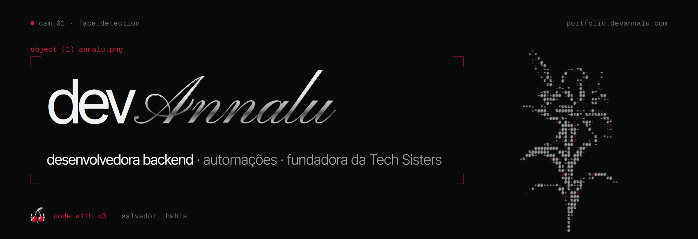

<a href="https://portfolio.devannalu.com">
  <picture>
    <source media="(prefers-color-scheme: light)" srcset="assets/banner-light.png" />
    
  </picture>
</a>

  
  
  
  

 

Oi, eu sou a **Anna Luiza**, a annalu. Sou desenvolvedora backend em Salvador e atuo com desenvolvimento de software e automações. Gosto de começar pelo problema: entender a rotina de quem vai usar, ver onde o trabalho se perde e só então decidir o que construir.

Também sou fundadora da **Tech Sisters**, uma comunidade de mulheres na tecnologia, e já fui professora de robótica e programação para crianças.

`object (2) projetos`

### O que eu ando construindo

| projeto | o que resolve |
|---|---|
| **Hub de Avaliação** | Levou para o digital a admissão de novos pacientes, que era toda feita no papel e na caneta, com os documentos gerados pelo próprio sistema. |
| **CRM personalizado** | Um CRM do jeito que a empresa trabalha, integrado ao Hub, com a avaliação do paciente nas mesmas telas. |
| **TI Control** | Cada equipamento rastreado da compra ao descarte, integrado ao Tactical RMM e com limpeza de disco automática. |
| **TS Workspace** | A central de operação da Tech Sisters: tarefas, projetos, eventos e comunicação num só lugar. |
| **Sisters Play** | Roleta de prêmios para eventos, com sorteio decidido no servidor e consentimento LGPD. |
| **Annalu Studio** | Meu centro de comando pessoal, com um pet que come o que eu entrego. |

São sistemas privados, então não tem link para produção. As prévias, com prints de dados fictícios, estão no **[portfólio →](https://portfolio.devannalu.com/#projetos)**

`object (3) stack`

### Com o que eu trabalho

  

`object (4) github`

### Por aqui

  
  

 

   
  <code>code with &lt;3 · salvador, bahia</code>

