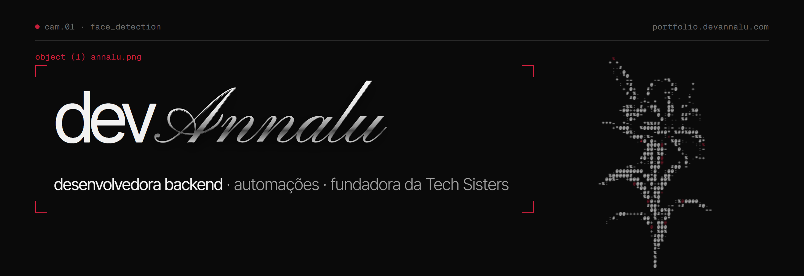
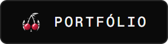
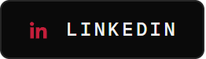
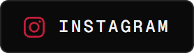
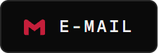
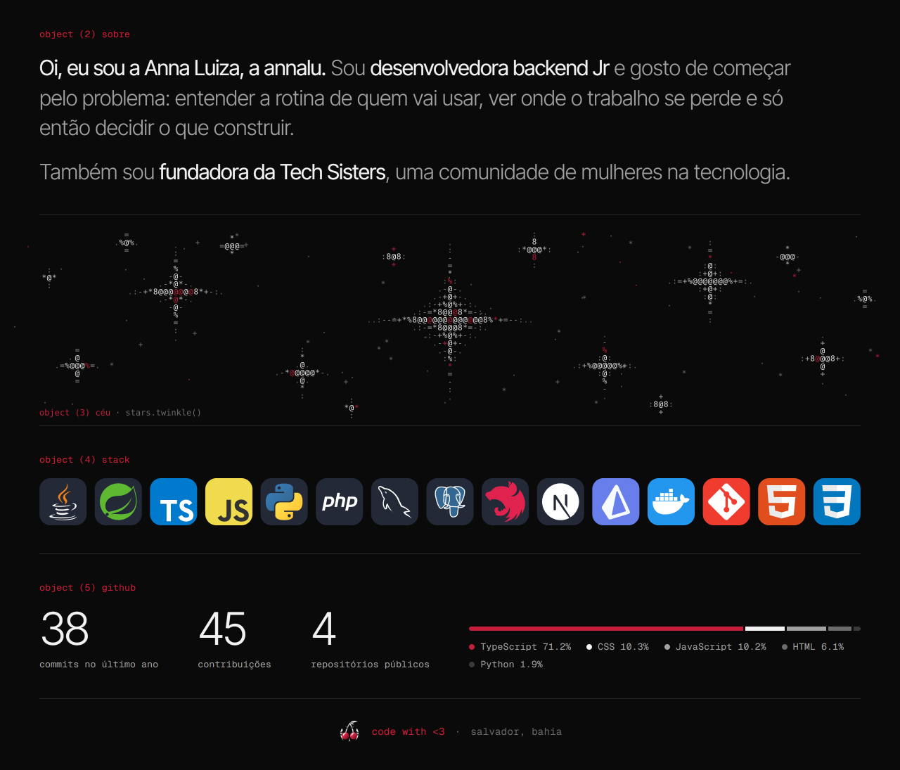

<a href="https://portfolio.devannalu.com">
  <picture>
    <source media="(prefers-color-scheme: light)" srcset="assets/topo-light.png" />
    
  </picture>
</a>

  <a href="https://portfolio.devannalu.com"><picture><source media="(prefers-color-scheme: light)" srcset="assets/botao-portfolio-light.png" /></picture></a>
  <a href="https://www.linkedin.com/in/devannalu"><picture><source media="(prefers-color-scheme: light)" srcset="assets/botao-linkedin-light.png" /></picture></a>
  <a href="https://www.instagram.com/dev.annalu/"><picture><source media="(prefers-color-scheme: light)" srcset="assets/botao-instagram-light.png" /></picture></a>
  <a href="mailto:devannalu0@gmail.com"><picture><source media="(prefers-color-scheme: light)" srcset="assets/botao-email-light.png" /></picture></a>

<a href="https://portfolio.devannalu.com">
  <picture>
    <source media="(prefers-color-scheme: light)" srcset="assets/perfil-light.svg" />
    
  </picture>
</a>

<picture>
  <source media="(prefers-color-scheme: light)" srcset="https://raw.githubusercontent.com/devannalu/devannalu/output/cobrinha-light.svg" />
  
</picture>
