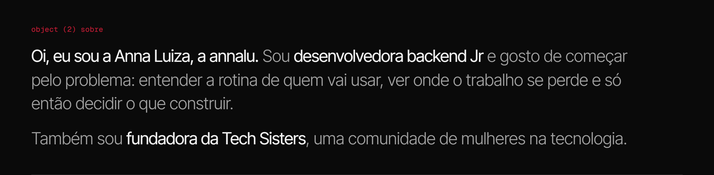
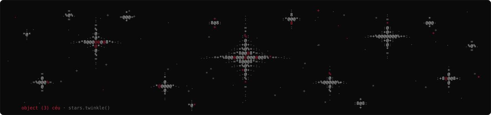
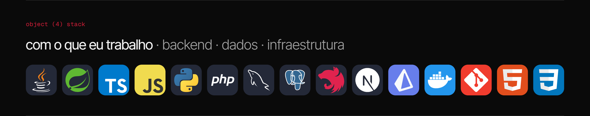
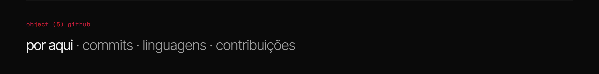

<a href="https://portfolio.devannalu.com">
  <picture>
    <source media="(prefers-color-scheme: light)" srcset="assets/banner-light.png" />
    
  </picture>
</a>

  
  
  
  

<picture>
  <source media="(prefers-color-scheme: light)" srcset="assets/sobre-light.png" />
  
</picture>

<picture>
  <source media="(prefers-color-scheme: light)" srcset="assets/estrelas-light.svg" />
  
</picture>

<picture>
  <source media="(prefers-color-scheme: light)" srcset="assets/stack-light.png" />
  
</picture>

<picture>
  <source media="(prefers-color-scheme: light)" srcset="assets/github-light.png" />
  
</picture>

  <picture>
    <source media="(prefers-color-scheme: light)" srcset="https://github-readme-stats.vercel.app/api?username=devannalu&show_icons=true&hide_border=true&bg_color=ffffff&title_color=5e0b1e&icon_color=5e0b1e&text_color=5c5c5c&hide_rank=true&disable_animations=true" />
    
  </picture>
  <picture>
    <source media="(prefers-color-scheme: light)" srcset="https://github-readme-stats.vercel.app/api/top-langs/?username=devannalu&layout=compact&hide_border=true&bg_color=ffffff&title_color=5e0b1e&text_color=5c5c5c&disable_animations=true" />
    
  </picture>

<picture>
  <source media="(prefers-color-scheme: light)" srcset="https://raw.githubusercontent.com/devannalu/devannalu/output/cobrinha-light.svg" />
  
</picture>

<picture>
  <source media="(prefers-color-scheme: light)" srcset="assets/rodape-light.png" />
  
</picture>
