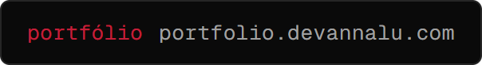
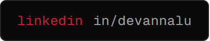
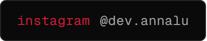
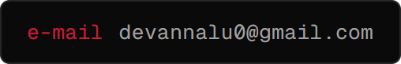
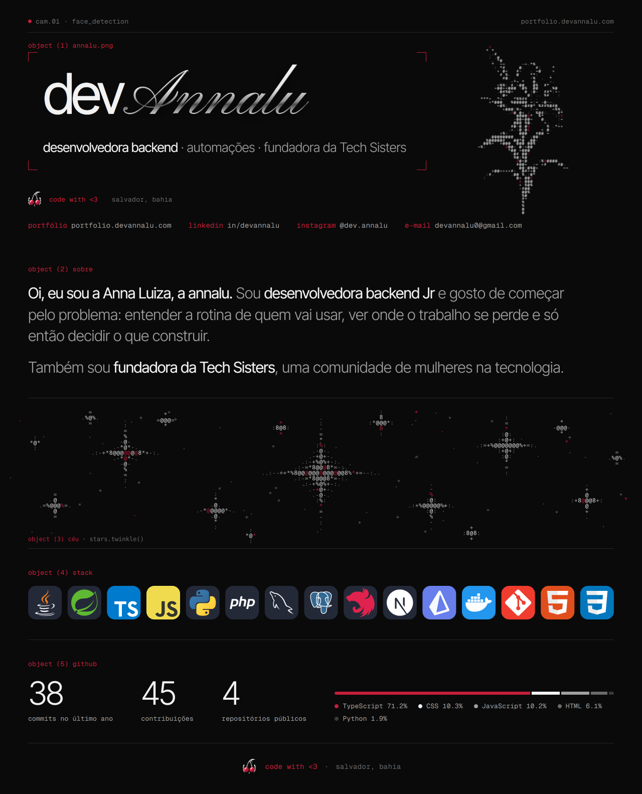

<a href="https://portfolio.devannalu.com">
  <picture>
    <source media="(prefers-color-scheme: light)" srcset="assets/banner-light.png" />
    
  </picture>
</a>

  <a href="https://portfolio.devannalu.com"><picture><source media="(prefers-color-scheme: light)" srcset="assets/selo-portfolio-light.png" /></picture></a>
  <a href="https://www.linkedin.com/in/devannalu"><picture><source media="(prefers-color-scheme: light)" srcset="assets/selo-linkedin-light.png" /></picture></a>
  <a href="https://www.instagram.com/dev.annalu/"><picture><source media="(prefers-color-scheme: light)" srcset="assets/selo-instagram-light.png" /></picture></a>
  <a href="mailto:devannalu0@gmail.com"><picture><source media="(prefers-color-scheme: light)" srcset="assets/selo-email-light.png" /></picture></a>

<a href="https://portfolio.devannalu.com">
  <picture>
    <source media="(prefers-color-scheme: light)" srcset="assets/readme-light.svg" />
    
  </picture>
</a>

<picture>
  <source media="(prefers-color-scheme: light)" srcset="https://raw.githubusercontent.com/devannalu/devannalu/output/cobrinha-light.svg" />
  
</picture>
